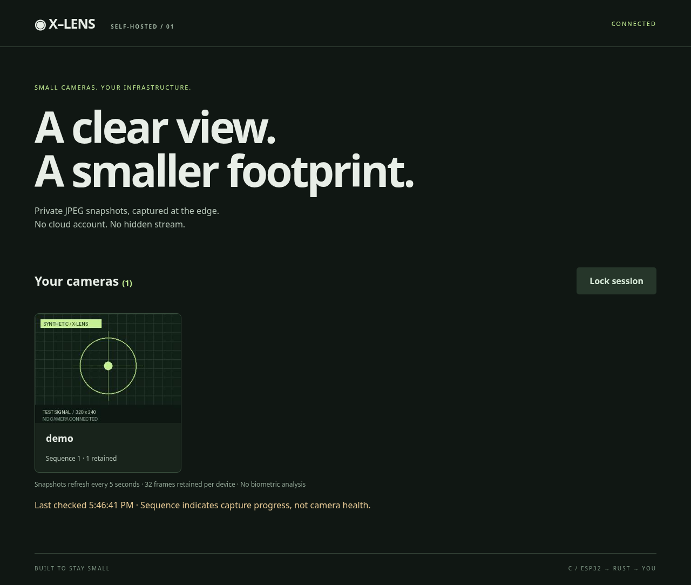

# X-Lens

**Tiny cameras. Intelligent oversight.** A minimal, self-hosted AI incident and JPEG snapshot
platform: C firmware for explicitly configured ESP32-CAM boards, a Rust origin server with **zero
external crates**, and a plain HTML/CSS/JS dashboard.

This is an experimental v0, not an audited security product. Capture, storage
and dashboard are self-hosted and work without cloud access. Real AI incident
review through the implemented Meta adapter requires **Meta cloud inference**;
a local open-weight inference backend is not implemented. No H.264, facial
recognition, or unmeasured FPS promise. Vendor camera/Wi-Fi/TLS
components and a standard TLS reverse proxy are necessary dependencies.

**Target hardware:** ESP32-CAM with an **ESP-32S module and OV3660 sensor**;
manufacturer unknown. Internal camera routing remains unverified. AI-Thinker
is only a named reference pin map, not the target board’s identity.
See [board selection](docs/HARDWARE.md).

## Local synthetic AI incident demo

Requires Rust stable and Python 3. No Python packages needed.

```sh
cargo build --release
python3 tools/setup_demo.py
# Terminal 1
./target/release/x-lens runtime/config.secret runtime/frames
# Terminal 2
python3 tools/demo_incident.py
```

Open http://127.0.0.1:8080 and enter the `viewer` value from
`runtime/config.secret`. Tokens stay in tab memory. Lock the session when done.
The demo uploads an original synthetic test-pattern JPEG, records five replay
rejections, and passes a clearly labeled **SIMULATED AI** response through the
real validation/report pipeline. The dashboard shows the correlated incident,
local policy and proposed human review. It never calls Meta or accesses a camera.
Do not put secrets in screenshots, shell history, URLs, or Git.

The server binds only to loopback. HTTPS at a trusted local reverse proxy is
mandatory for cameras or remote dashboard access. See the deployment, protocol,
and hardware documentation as added in the following implementation commits.

## Webcam, voice drafts and local rules

The dashboard now separates overview, sources, incidents and rules. Preview a
webcam, then explicitly start authenticated snapshots; no ESP32 is needed for
local testing. Draft a supported rule by typing or opt-in browser speech,
review its fields and explicitly confirm with the separate operator credential.
Local rules produce bounded UI events, never execute model commands. Browser
speech may use a vendor cloud service; typed rules work offline.
See [local workflows and limitations](docs/LOCAL_WORKFLOWS.md).

## AI-assisted development

This project is being developed with AI assistance, including implementation,
documentation, and test generation. Human maintainers remain responsible for
reviewing changes and deciding whether the system is suitable for their use.
Automated checks do not constitute an independent security audit. Hardware
operation, electrical safety, sustained capture, and real-world reliability have
**not been validated on a physical ESP32-CAM**. Do not treat generated code or
passing host tests as proof of production security.



## Architecture

```text
ESP32-CAM (C, JPEG, one framebuffer, device token)
    │ verified HTTPS, bounded POST, persistent sequence
    ▼
Caddy (standard TLS boundary) → 127.0.0.1:8080 Rust origin
                                  ├── private bounded snapshot store
                                  ├── authenticated browser dashboard
                                  └── incident review: JPEG + telemetry → Meta cloud AI
                                      (manual, budgeted; simulated demo available)
```

The camera never sees external AI/API keys. The standard-library Python adapter
supports **Meta Model API** image understanding and an advisory cybersecurity
review of bounded numeric telemetry. The concrete Meta wire format follows
[official documentation](https://dev.meta.ai/docs/protocols/chat-completions);
only synthetic/mock tests have run, not real Meta calls. The event's public page lists Meta Model API; the participant's
account entitlement and available model ID still need confirmation. A generic JSON image
adapter remains optional; it is not labeled as a Meta integration.

```sh
python3 tools/analyze.py --mode image       # dry-run: no external call
python3 tools/analyze.py --mode security    # local policy and request preview
python3 tools/analyze.py --mode incident    # image + security evidence in one request
```

The model can suggest a human review of authentication failures, repeated
sequences or invalid frames. It **cannot generate credentials, authenticate
users, execute commands, or quarantine devices**. Local deterministic rules
remain authoritative; every consequential response requires human review. See
[Meta AI and security review](docs/META_AI.md) and [setup](docs/SETUP.md).

| Component | Deliberate budget |
|---|---|
| Origin binary | Zero third-party Rust crates; four worker threads |
| JPEG / headers | 128 KiB / 4 KiB maximum |
| Devices / retention | 16 devices / 32 snapshots each |
| Camera | One JPEG framebuffer; one HTTPS upload at a time |
| AI requests | One correlated image + telemetry review; 10/day default budget, ≥60 s gap, no retries |

## Documentation and validation

- [Hackathon demo and AI workflow](docs/DEMO.md)
- [Setup, TLS and API integration](docs/SETUP.md)
- [Firmware build, provisioning and hardware checklist](docs/HARDWARE.md)
- [Protocol, limits and crash semantics](docs/PROTOCOL.md)
- [Threat model and limitations](docs/SECURITY.md)
- [Measured host benchmark](docs/benchmark.json) and [validation record](docs/VALIDATION.md)
- [CI](https://github.com/jveliz-08/X-Lens/actions)

```sh
cargo fmt --check
cargo clippy --all-targets -- -D warnings
cargo test
cargo build --release
python3 tests/integration.py
python3 -m unittest discover -s tests -p 'test_*.py' -v
python3 tools/benchmark.py
```

Stop other instances on port 8080 before integration tests/benchmark. Tests use
private temporary directories and synthetic images. No deployment, camera
access, firmware flashing, or real external AI calls are required.

Original project code is MIT licensed. ESP-IDF, camera driver, Caddy and toolchain
components retain their upstream licenses; they are not copied into this repo.
